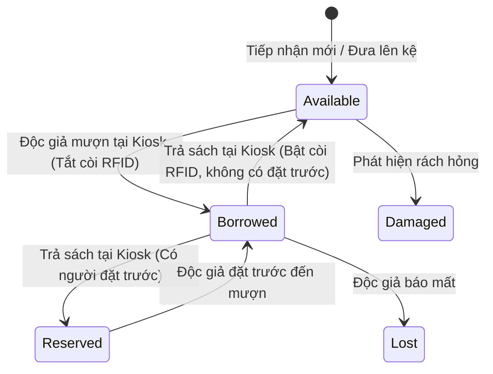

# TÀI LIỆU THIẾT KẾ VÀ ĐẶC TẢ USE CASE HỆ THỐNG THƯ VIỆN RFID (LMS)
**Môn học:** Phân tích và Thiết kế Hướng đối tượng (CMP3019)  
**Trường Đại học Công nghệ TP.HCM (HUTECH) - Khoa Công nghệ Thông tin**  
**Đồ án:** Hệ thống Quản lý Thư viện thông minh tích hợp RFID (Proof of Concept - PoC)

---

## PHẦN 1: TỔNG HỢP & CHỐT NHẤT QUÁN CÁC ĐIỂM THIẾT KẾ (DESIGN DECISIONS)

Qua quá trình đối chiếu giữa **Use Case Diagram**, **Use Case Specification**, **Activity Diagram**, **Sequence Diagram**, **Class Diagram** và mã nguồn **PoC ASP.NET Core (.NET 8)**, toàn bộ 7 điểm sai lệch đã được chốt và chuẩn hóa như sau:

| STT | Vấn đề đối chiếu | Quyết định chốt | Lý do & Thống nhất kỹ thuật |
| :---: | :--- | :--- | :--- |
| **1** | **Actor luồng "Trả sách"** (Thủ thư vs Độc giả tại Kiosk) | **Độc giả (Reader / Borrower)** | Đồ án xây dựng trạm Kiosk RFID tự phục vụ (`Return.cshtml`). Độc giả tự đặt sách lên khay và xác nhận trả. Sequence Diagram bắt đầu từ lifeline `:Độc giả`. |
| **2** | **Trạng thái `BookItem` sau khi trả** | **`Available`** (hoặc `Reserved` nếu có người đặt trước) | Khớp 100% với `seed.sql` và code PoC. Bổ sung danh mục trạng thái: `Available`, `Borrowed`, `Reserved`, `Reshelving`, `Damaged`, `Lost`. |
| **3** | **Ngưỡng khóa tài khoản** (`> 50.000` vs `>= 50.000`) | **`>= 50.000`** (Lớn hơn hoặc bằng) | 50.000 VNĐ là ngưỡng trần tối đa cho phép nợ (10 ngày x 5.000đ/ngày). Chạm mốc này là khóa ngay để tránh nợ xấu. Đồng bộ code `totalFines >= FineLockThreshold`. |
| **4** | **Class Fine cần thêm `loanID` (FK)** | **Thêm `loanID: string` vào `Fine`** | Quan hệ `Loan 1 - 0..* Fine` trong CSDL (`schema.sql`) và thực thể `Fine.cs`. Class Diagram vẽ Association `Loan (1)` -> `Fine (0..*)`. |
| **5** | **Mã chip RFID** | **Chính là `BookItem.bookID`** | `Book` là đầu sách chung (ISBN), `BookItem` là cuốn sách vật lý. Mã chip RFID (`RFID-001`,...) được lưu trực tiếp vào trường khóa chính `bookID`. |
| **6** | **Phương thức `calculateFine`** | **Nằm ở `Loan` / `Fine`, Controller chỉ gọi** | Tuân thủ nguyên lý GRASP Information Expert: `Loan` tính số ngày quá hạn, `Fine` tính số tiền phạt. `ReturnController` điều phối luồng, không ôm logic tính toán. |
| **7** | **Danh mục Use Case cập nhật** | **5 Use Case cốt lõi hoàn chỉnh** | Bổ sung đầy đủ Use Case Spec theo ngữ pháp chuẩn SVDPI cho: Mượn sách, Trả sách, Đặt trước, Xử lý tiền phạt, Quản lý thẻ độc giả. |

---

## PHẦN 2: DANH MỤC TRẠNG THÁI BOOKITEM (LIFECYCLE STATE MACHINE)

- **`Available` (Khả dụng):** Sách đang nằm trên kệ, còi bảo mật RFID kích hoạt (`isSecurityEnabled = 1`).
- **`Borrowed` (Đang mượn):** Sách do độc giả giữ, còi bảo mật đã tắt (`isSecurityEnabled = 0`), gắn với `LoanID`.
- **`Reserved` (Đang giữ chỗ):** Sách được giữ riêng cho người có `Reservation` hợp lệ, còi bảo mật bật.
- **`Reshelving` (Chờ xếp kệ):** Trạng thái trung gian khi sách vừa trả vào thùng thu gom tại Kiosk.
- **`Damaged` (Hư hỏng):** Tạm ngưng lưu thông chờ sửa chữa/phục hồi.
- **`Lost` (Báo mất):** Độc giả báo mất hoặc kiểm kê thất lạc, kích hoạt quy trình bồi thường.

---

## PHẦN 3: BẢN ĐẶC TẢ USE CASE CHI TIẾT (CHUẨN SVDPI)

---

### USE CASE 01: MƯỢN SÁCH TẠI KIOSK (SELF-SERVICE CHECKOUT)

#### 1. METADATA
- **Use Case ID:** UC01_CHECKOUT_KIOSK
- **Use Case Name:** Mượn sách tại Kiosk tự phục vụ (Self-Service Checkout)
- **Primary Actor:** Độc giả (Reader)
- **Secondary Actor:** CSDL Thư viện (Library Database)
- **Description:** Độc giả tự quét thẻ thư viện và đặt các cuốn sách lên khay quét RFID của Kiosk để thực hiện mượn sách tự động mà không cần qua quầy thủ thư.
- **Trigger:** Độc giả đặt thẻ vào đầu đọc RFID tại Kiosk mượn sách.
- **Priority:** Cao (High) - Nghiệp vụ cốt lõi của PoC.

#### 2. TIỀN ĐIỀU KIỆN & HẬU ĐIỀU KIỆN
- **Pre-conditions:**
  1. Trạm Kiosk đang hoạt động bình thường và kết nối mạng ổn định với CSDL Thư viện.
  2. Độc giả có thẻ thư viện hợp lệ với trạng thái hoạt động (`accountStatus = 'Active'`).
  3. Tổng tiền nợ phạt của độc giả chưa chạm ngưỡng khóa (`totalFines < 50.000 VNĐ`).
  4. Các tài liệu cần mượn có trạng thái `Available` trên kệ.
- **Post-conditions:**
  - **Success:**
    - Các bản ghi `Loan` mới được tạo trong CSDL với hạn trả mặc định 14 ngày.
    - Trạng thái các cuốn sách được cập nhật thành `Borrowed`, còi bảo mật tắt (`isSecurityEnabled = 0`).
    - Biên nhận mượn sách điện tử hiển thị trên màn hình và in biên lai giấy cho độc giả.
  - **Failure:** Giao dịch bị hủy bỏ, trạng thái sách và tài khoản giữ nguyên vẹn.

#### 3. NORMAL FLOW (LUỒNG CHÍNH - 7 BƯỚC SVDPI)
1. Độc giả **[S]** quét **[V]** thẻ thư viện RFID **[D]** tại **[P]** đầu đọc thẻ của Kiosk **[I]**.
2. Hệ thống **[S]** xác thực **[V]** trạng thái hoạt động và công nợ phạt của tài khoản **[D]** trong **[P]** CSDL **[I]**.
3. Độc giả **[S]** đặt **[V]** chồng sách cần mượn **[D]** lên **[P]** khay quét RFID **[I]**.
4. Hệ thống **[S]** nhận diện **[V]** danh sách mã RFID các cuốn sách **[D]** bằng **[P]** ăng-ten đa hướng **[I]**.
5. Độc giả **[S]** nhấn **[V]** nút 'Xác nhận mượn' **[D]** trên **[P]** màn hình cảm ứng **[I]**.
6. Hệ thống **[S]** tạo **[V]** các bản ghi phiếu mượn và tắt còi bảo mật RFID của tài liệu **[D]** vào **[P]** CSDL **[I]** *(Thao tác Fork/Join)*.
7. Hệ thống **[S]** hiển thị **[V]** thông báo mượn sách thành công cùng thời hạn 14 ngày **[D]** cho **[P]** độc giả **[I]**.

#### 4. CÁC LUỒNG NGOẠI LỆ (EXCEPTION FLOWS)
- **Luồng 2a: Tài khoản bị khóa do nợ phạt >= 50.000 VNĐ**
  - *Xử lý:* Kiosk hiển thị cảnh báo từ chối giao dịch: "Tài khoản bị khóa do nợ phạt quá hạn mức (>= 50.000đ). Vui lòng thanh toán tiền phạt để mở khóa". Kiosk nhả thẻ. Use case kết thúc.
- **Luồng 4a: Vượt quá giới hạn mượn sách (BorrowLimit)**
  - *Xử lý:* Hệ thống cảnh báo tổng số sách đang mượn vượt quá hạn mức (5 cuốn đối với sinh viên). Yêu cầu độc giả bớt sách khỏi khay quét.
- **Luồng 4b: Sách có người đặt trước hoặc không khả dụng**
  - *Xử lý:* Hệ thống báo đỏ cuốn sách bị trùng lịch đặt trước, chỉ cho phép mượn các cuốn hợp lệ còn lại.

---

### USE CASE 02: TRẢ SÁCH TẠI KIOSK (SELF-SERVICE RETURN)

#### 1. METADATA
- **Use Case ID:** UC02_RETURN_KIOSK
- **Use Case Name:** Trả sách tại Kiosk tự phục vụ (Self-Service Return)
- **Primary Actor:** Độc giả (Reader)
- **Secondary Actor:** CSDL Thư viện (Library Database)
- **Description:** Độc giả đặt các tài liệu cần trả lên khay quét RFID của Kiosk để hệ thống tự động ghi nhận hoàn trả, tính toán tiền phạt quá hạn (nếu có) và kích hoạt lại còi bảo mật.
- **Trigger:** Độc giả chọn tính năng *"Trả sách"* trên màn hình Kiosk.
- **Priority:** Cao (High) - Nghiệp vụ cốt lõi của PoC.

#### 2. TIỀN ĐIỀU KIỆN & HẬU ĐIỀU KIỆN
- **Pre-conditions:**
  1. Trạm Kiosk đang sẵn sàng tiếp nhận tài liệu.
  2. Các tài liệu mang đến trả đã được gắn chip RFID của thư viện và đang ở trạng thái `Borrowed`.
- **Post-conditions:**
  - **Success:**
    - CSDL cập nhật `Loan.returnDate = Ngày hiện tại`, `Loan.status = 'Returned'`.
    - Trạng thái `BookItem.status` đổi thành `Available` (hoặc `Reserved`), còi bảo mật được bật lại (`isSecurityEnabled = 1`).
    - Nếu trả trễ hạn, hệ thống tự sinh bản ghi `Fine` gắn với `loanID` và cộng dồn vào `Reader.totalFines`.
  - **Failure:** Giao dịch dừng lại, thông báo lỗi được hiển thị.

#### 3. NORMAL FLOW (LUỒNG CHÍNH - 7 BƯỚC SVDPI)
1. Độc giả **[S]** đặt **[V]** danh sách các cuốn sách cần trả **[D]** lên **[P]** khay quét RFID của Kiosk **[I]**.
2. Hệ thống **[S]** nhận diện **[V]** toàn bộ mã RFID của các tài liệu **[D]** qua **[P]** đầu đọc RFID **[I]**.
3. Hệ thống **[S]** truy vấn **[V]** thông tin phiếu mượn tương ứng của từng cuốn sách **[D]** từ **[P]** CSDL **[I]**.
4. Hệ thống **[S]** kiểm tra **[V]** thời hạn mượn và tính toán tiền phạt quá hạn **[D]** theo **[P]** quy định thư viện **[I]**.
5. Độc giả **[S]** nhấn **[V]** nút 'Xác nhận trả' **[D]** trên **[P]** giao diện Kiosk **[I]**.
6. Hệ thống **[S]** ghi nhận **[V]** ngày trả, kích hoạt còi bảo mật RFID và cập nhật trạng thái sách thành 'Available' **[D]** vào **[P]** CSDL **[I]** *(Thao tác Fork/Join)*.
7. Hệ thống **[S]** in **[V]** biên nhận xác nhận trả sách thành công **[D]** cho **[P]** độc giả **[I]**.

#### 4. CÁC LUỒNG NGOẠI LỆ (EXCEPTION FLOWS)
- **Luồng 4a: Phát hiện sách trả quá hạn**
  - *Xử lý:* Hệ thống hiển thị số ngày trễ hạn và số tiền phạt phát sinh (5.000đ/ngày). Tự động tạo bản ghi `Fine` với `status = 'Unpaid'`, gán `loanID` tương ứng, và hiển thị thông báo hướng dẫn nộp phạt.
- **Luồng 6a: Sách đã được độc giả khác đặt trước**
  - *Xử lý:* CSDL cập nhật trạng thái sách thành `Reserved`, gửi email thông báo cho người đặt trước và hướng dẫn độc giả đặt cuốn sách vào ngăn giữ riêng.

---

### USE CASE 03: ĐẶT TRƯỚC TÀI LIỆU (RESERVE BOOK)

#### 1. METADATA
- **Use Case ID:** UC03_RESERVE_BOOK
- **Use Case Name:** Đặt trước tài liệu (Reserve Book)
- **Primary Actor:** Độc giả (Reader)
- **Secondary Actor:** CSDL Thư viện (Library Database)
- **Description:** Độc giả đăng ký giữ chỗ trước một đầu sách hiện không còn cuốn nào sẵn sàng trên kệ để được thông báo mượn ngay khi có người trả.
- **Trigger:** Độc giả nhấn nút *"Đặt trước"* khi tra cứu thấy sách đang được mượn hết.
- **Priority:** Trung bình (Medium).

#### 2. TIỀN ĐIỀU KIỆN & HẬU ĐIỀU KIỆN
- **Pre-conditions:**
  1. Độc giả đã đăng nhập tài khoản thư viện hợp lệ (`accountStatus = 'Active'`).
  2. Tất cả các bản sao (`BookItem`) của đầu sách đều đang ở trạng thái `Borrowed`.
  3. Độc giả chưa vượt quá giới hạn đặt trước (tối đa 3 cuốn).
- **Post-conditions:**
  - **Success:** Bản ghi `Reservation` mới được lưu với `status = 'Active'`; độc giả được thêm vào danh sách chờ.
  - **Failure:** Yêu cầu bị từ chối, dữ liệu giữ nguyên.

#### 3. NORMAL FLOW (LUỒNG CHÍNH - 7 BƯỚC SVDPI)
1. Độc giả **[S]** gửi **[V]** yêu cầu đặt trước tài liệu **[D]** đến **[P]** hệ thống LMS **[I]**.
2. Hệ thống **[S]** kiểm tra **[V]** số lượng tài liệu đang đặt trước của độc giả **[D]** trong **[P]** CSDL **[I]**.
3. Hệ thống **[S]** xác minh **[V]** trạng thái các bản sao của đầu sách **[D]** trong **[P]** CSDL **[I]**.
4. Hệ thống **[S]** hiển thị **[V]** hộp thoại xác nhận đặt giữ chỗ **[D]** cho **[P]** độc giả **[I]**.
5. Độc giả **[S]** xác nhận **[V]** giao dịch đặt giữ tài liệu **[D]** trên **[P]** hộp thoại **[I]**.
6. Hệ thống **[S]** lưu **[V]** bản ghi đặt trước và thêm độc giả vào danh sách chờ **[D]** vào **[P]** CSDL **[I]** *(Thao tác Fork/Join)*.
7. Hệ thống **[S]** gửi **[V]** email thông báo xác nhận đặt trước thành công **[D]** cho **[P]** độc giả **[I]**.

#### 4. CÁC LUỒNG NGOẠI LỆ (EXCEPTION FLOWS)
- **Luồng 2a: Độc giả đã đặt >= 3 cuốn**
  - *Xử lý:* Hệ thống hiển thị cảnh báo vượt hạn mức đặt trước. Hủy giao dịch.
- **Luồng 3a: Còn bản sao khả dụng trên kệ**
  - *Xử lý:* Hệ thống thông báo: "Tài liệu vẫn còn bản sao trên kệ sách, vui lòng mượn trực tiếp tại Kiosk". Chỉ dẫn vị trí kệ sách.

---

### USE CASE 04: XỬ LÝ TIỀN PHẠT (PROCESS OVERDUE FINE)

#### 1. METADATA
- **Use Case ID:** UC04_PROCESS_FINE
- **Use Case Name:** Xử lý tiền phạt (Process Overdue Fine)
- **Primary Actor:** Thủ thư (Librarian) / Độc giả (tại Kiosk)
- **Secondary Actor:** Cổng thanh toán (Payment Gateway), CSDL Thư viện
- **Description:** Thực hiện thu tiền phạt quá hạn/hư hỏng, cập nhật công nợ và tự động mở khóa thẻ thư viện khi nợ giảm xuống dưới ngưỡng 50.000 VNĐ.
- **Priority:** Cao (High).

#### 2. TIỀN ĐIỀU KIỆN & HẬU ĐIỀU KIỆN
- **Pre-conditions:** Độc giả có ít nhất một khoản phạt `Fine.status = 'Unpaid'` và `Reader.totalFines > 0`.
- **Post-conditions:**
  - **Success:** `Fine.status = 'Paid'`, giảm trừ `Reader.totalFines`. Nếu `totalFines < 50.000`, hệ thống tự mở khóa tài khoản `accountStatus = 'Active'`. In biên lai thu tiền.

#### 3. NORMAL FLOW (LUỒNG CHÍNH - 7 BƯỚC SVDPI)
1. Thủ thư **[S]** nhập **[V]** mã số độc giả **[D]** vào **[P]** phân hệ quản lý tiền phạt **[I]**.
2. Hệ thống **[S]** truy vấn **[V]** danh sách các phiếu phạt chưa thanh toán **[D]** từ **[P]** CSDL **[I]**.
3. Hệ thống **[S]** hiển thị **[V]** tổng tiền phạt cần nộp **[D]** cho **[P]** thủ thư **[I]**.
4. Độc giả **[S]** bàn giao **[V]** số tiền thanh toán **[D]** cho **[P]** thủ thư **[I]**.
5. Thủ thư **[S]** xác nhận **[V]** hoàn tất thu tiền phạt **[D]** trên **[P]** hệ thống LMS **[I]**.
6. Hệ thống **[S]** cập nhật **[V]** trạng thái phiếu phạt thành 'Paid' và giảm trừ công nợ của độc giả **[D]** vào **[P]** CSDL **[I]** *(Thao tác Fork/Join)*.
7. Hệ thống **[S]** in **[V]** biên lai thu tiền phạt **[D]** cho **[P]** độc giả **[I]**.

#### 4. CÁC LUỒNG NGOẠI LỆ (EXCEPTION FLOWS)
- **Luồng 4a: Thanh toán trực tuyến qua mã QR**
  - *Xử lý:* Độc giả quét mã QR tại Kiosk/Cổng thông tin. Khi cổng thanh toán xác nhận giao dịch thành công, hệ thống tự động chuyển tiếp Bước 6.
- **Luồng 6a: Nợ sau thanh toán vẫn >= 50.000 VNĐ**
  - *Xử lý:* Nếu độc giả chỉ trả một phần và nợ còn tồn đọng >= 50.000, hệ thống duy trì trạng thái `accountStatus = 'Locked'`.

---

### USE CASE 05: QUẢN LÝ THẺ ĐỘC GIẢ (MANAGE READER CARD)

#### 1. METADATA
- **Use Case ID:** UC05_MANAGE_CARD
- **Use Case Name:** Quản lý thẻ độc giả (Manage Reader Card)
- **Primary Actor:** Thủ thư (Librarian)
- **Secondary Actor:** Hệ thống Phòng Đào tạo (Registrar System), CSDL Thư viện
- **Description:** Thủ thư thực hiện cấp mới, kích hoạt chip RFID thẻ, gia hạn hoặc khóa thẻ khi sinh viên báo mất thẻ.
- **Priority:** Trung bình (Medium).

#### 2. TIỀN ĐIỀU KIỆN & HẬU ĐIỀU KIỆN
- **Pre-conditions:** Thủ thư đăng nhập với quyền hạn quản lý bạn đọc (`RoleLevel = 'Staff'` hoặc `'Admin'`).
- **Post-conditions:** Hồ sơ thẻ độc giả (`User` và `Reader`) được tạo mới hoặc cập nhật trạng thái (`Active`, `Locked`, `Expired`) trong CSDL.

#### 3. NORMAL FLOW (LUỒNG CHÍNH - 7 BƯỚC SVDPI)
1. Thủ thư **[S]** nhập **[V]** mã số sinh viên **[D]** vào **[P]** phân hệ quản lý thẻ độc giả **[I]**.
2. Hệ thống **[S]** gửi **[V]** yêu cầu tra cứu dữ liệu học vụ **[D]** sang **[P]** Hệ thống Đào tạo **[I]**.
3. Hệ thống Đào tạo **[S]** trả lời **[V]** thông tin sinh viên đang học tập hợp lệ **[D]** cho **[P]** hệ thống LMS **[I]**.
4. Hệ thống **[S]** tải **[V]** biểu mẫu cấp thẻ cùng hạn mức mượn sách 5 cuốn **[D]** lên **[P]** màn hình thủ thư **[I]**.
5. Thủ thư **[S]** chọn **[V]** thao tác kích hoạt cấp thẻ mới **[D]** trên **[P]** giao diện hệ thống **[I]**.
6. Hệ thống **[S]** lưu **[V]** thông tin thẻ độc giả với trạng thái 'Active' **[D]** vào **[P]** CSDL **[I]**.
7. Hệ thống **[S]** phát hành **[V]** thông báo thẻ đã kích hoạt thành công **[D]** cho **[P]** thủ thư **[I]**.

#### 4. CÁC LUỒNG NGOẠI LỆ (EXCEPTION FLOWS)
- **Luồng 3a: Sinh viên đã tốt nghiệp hoặc bị đình chỉ học tập**
  - *Xử lý:* Hệ thống hiển thị cảnh báo không đủ điều kiện cấp thẻ. Dừng giao dịch.
- **Luồng 5a: Khóa thẻ khẩn cấp khi độc giả báo mất**
  - *Xử lý:* Thủ thư chọn *"Khóa thẻ do mất"*. CSDL cập nhật `accountStatus = 'Locked'`, Kiosk lập tức từ chối thẻ này.

---

## PHẦN 4: MA TRẬN TRACEABILITY ĐỐI CHIẾU TOÀN DIỆN

| Use Case ID & Tên | Primary Actor | Entities tương tác chính | Trạng thái nghiệp vụ / Dữ liệu cập nhật | Cột / Thuộc tính tương ứng trong CSDL |
| :--- | :--- | :--- | :--- | :--- |
| **UC01: Mượn sách tại Kiosk** | Độc giả (Kiosk) | `User`, `Reader`, `BookItem`, `Loan` | `BookItem.status = 'Borrowed'`, `isSecurityEnabled = 0`, tạo `Loan` (hạn 14 ngày). Kiểm tra `totalFines < 50.000`. | `BookItems.isSecurityEnabled`, `Loans.dueDate`, `Loans.status` |
| **UC02: Trả sách tại Kiosk** | Độc giả (Kiosk) | `BookItem`, `Loan`, `Fine`, `Reader` | `BookItem.status = 'Available'`, `isSecurityEnabled = 1`, `Loan.status = 'Returned'`. Tự tạo `Fine` nếu trễ hạn. | `Loans.returnDate`, `Fines.loanID`, `Readers.totalFines` |
| **UC03: Đặt trước tài liệu** | Độc giả | `Reader`, `Book`, `BookItem`, `Reservation` | `Reservation.status = 'Active'`. Giới hạn <= 3 cuốn. Kiểm tra toàn bộ bản sao = `Borrowed`. | `Reservations.expirationDate`, `Reservations.status` |
| **UC04: Xử lý tiền phạt** | Thủ thư / Độc giả | `Reader`, `Fine`, `Loan`, `User` | `Fine.status = 'Paid'`, trừ `Reader.totalFines`. Tự mở khóa `accountStatus = 'Active'` nếu `< 50.000`. | `Fines.status`, `Readers.totalFines`, `Users.accountStatus` |
| **UC05: Quản lý thẻ độc giả** | Thủ thư | `User`, `Reader`, Hệ thống Đào tạo | Thiết lập `accountStatus` (`Active` / `Locked`), định mức `borrowLimit = 5`. | `Users.accountStatus`, `Readers.borrowLimit` |
